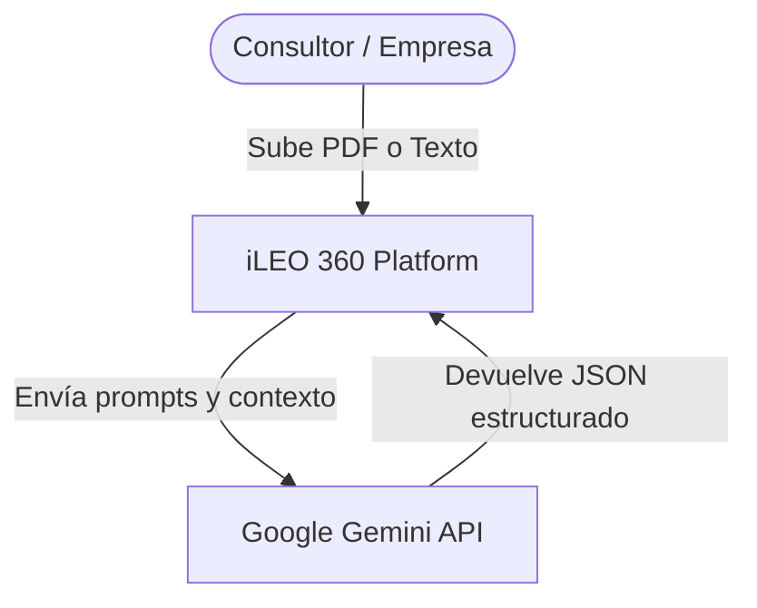
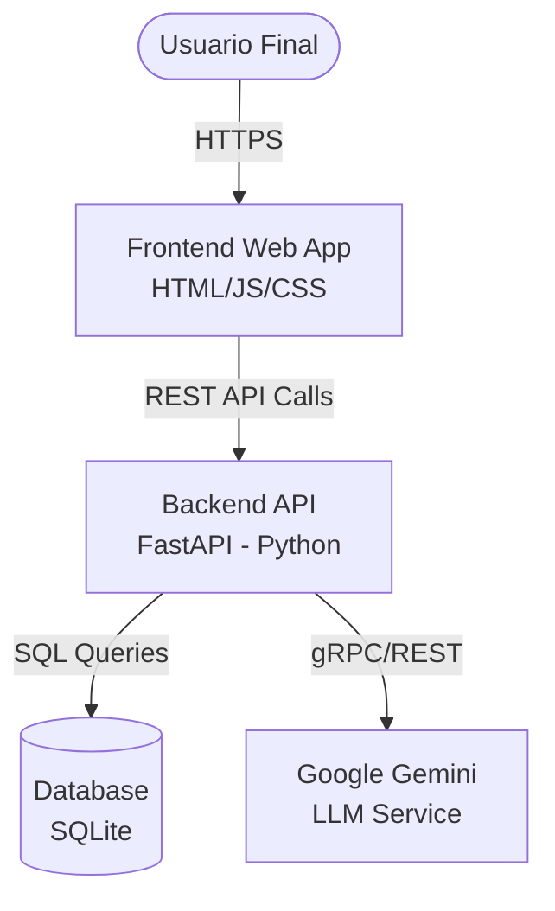
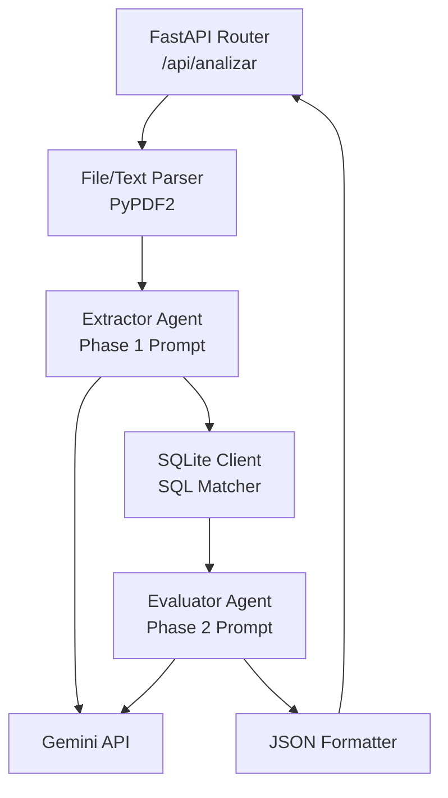

# 🏗️ Arquitectura Técnica y Diagramas C4

iLEO 360 sigue una arquitectura ligera, modular y preparada para escalar. Combina tecnologías tradicionales de bases de datos con Inteligencia Artificial generativa.

## Stack Tecnológico Actual (MVP)
*   **Frontend:** HTML5, CSS3 (Glassmorphism), Vanilla JS (Fetch API).
*   **Backend:** Python 3, FastAPI.
*   **Base de Datos:** SQLite (Migrable a PostgreSQL).
*   **Inteligencia Artificial:** Google Gemini 1.5 Flash (via API).

---

## Diagramas C4 (Mermaid)

### Nivel 1: Contexto del Sistema (System Context)
Muestra cómo iLEO 360 interactúa con los usuarios y los sistemas externos.

### Nivel 2: Contenedores (Containers)
Desglose interno de la aplicación en sus principales contenedores ejecutables.

### Nivel 3: Componentes del Backend (Components)
Detalle del flujo interno dentro de la API de FastAPI durante una petición.

